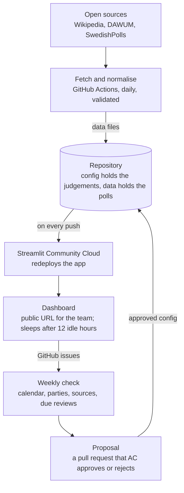

# European election polling dashboard — build spec v0.1

As of 23 Nov 2026 · Owner: AC

> Exported from the living spec on 23 Nov 2026. From the first commit, this file is the
> source of truth for the build. Change it by pull request, never in passing.

A tab-per-country Streamlit dashboard of election polling for 17 European countries plus the UK,
deployed from a public GitHub repository. National contests headline each tab, sub-national contests
sit in foldable sections, parties line up left to right on a spectrum strip, and every classification
call is logged in a reviewable judgement register.

## 1. Scope and definitions

The dashboard has 18 country tabs: DE, FR, IT, ES, NL, BE, AT, PT, IE, GR, PL, HU, CZ, NO, SE, FI, DK
and UK. Two notes on the list as given: "SW" is read as Sweden (SE), and Norway and the UK sit outside
the EU but are in scope. The other 11 EU members are out of scope for v1; the data model lets a country
be added by configuration alone.

Two rules set what leads a tab. **A contest is national if the whole national electorate votes in it.
Where the president is directly elected, the presidential contest headlines the tab and the
parliamentary contest sits beneath it as a subsection; elsewhere the parliament headlines.** Everything
below is those rules applied.

| Term | Rule |
| --- | --- |
| Contest | One election for one body or office, in one territory, on one date. Two-round elections are one contest with two rounds. |
| Headline | The presidential contest in the seven countries that elect a president directly: FR, AT, PT, IE, FI, CZ, PL. In the other eleven, voting intention for the lower house or unicameral parliament. |
| Parliamentary subsection | On the seven presidential-first tabs, the parliamentary contest is the first foldable section under the headline, open by default. |
| No presidential polls yet | The headline shows the next presidential date and a "not yet polled" line until three polls exist. The parliamentary subsection carries the tab meanwhile. |
| Sub-national (foldable) | Direct elections to a tier with its own government below the national level: Länder, autonomous communities, regions, devolved nations, provinces, counties. |
| Regional cut of a national contest | A poll of national voting intention taken in one region (Westminster intention in Scotland, Bundestag intention in Bavaria). Belongs to the national panel as a breakdown, never to a sub-national section. |
| Out of scope for v1 | Municipal and mayoral elections (London included), the Faroe Islands and Greenland, European Parliament 2029, referendums, indirect elections (German federal president, Dutch and French senates). The calendar still lists them where they move national timing. |
| Upcoming | Every tab always shows the next national contests with their dates or legal deadlines. A sub-national section appears when its election is within 18 months, or has at least 3 polls in the last 12 months. |
| After polling day | The contest switches to a result-versus-final-polls view for 30 days, then rolls to the next cycle. |

The 18-month window, 3-poll floor and 30-day roll are configuration values, not code
(`config/settings.yaml`).

## 2. Election calendar

Six national contests fall in the next 13 months: Spain on 29 Nov 2026, France and Finland on
18 Apr 2027, Greece by 25 July, Poland by 11 Nov and Italy by 22 Dec 2027. Sweden may add a seventh:
it voted on 13 Sep 2026 and still has no government.

| Country | Next national contest | Date or deadline | Status | Sub-national contests ahead |
| --- | --- | --- | --- | --- |
| ES | Congress and Senate | 29 Nov 2026 | Called early on 5 Oct 2026 | 10 autonomous communities, 23 May 2027 |
| FR | Presidential; National Assembly | 18 Apr and 2 May 2027; Assembly term runs to June 2029 | Presidential dates fixed. A dissolution after the presidential vote is widely expected, not scheduled | Regional and departmental, 2028 |
| FI | Eduskunta | 18 Apr 2027 | Fixed | Åland, by Oct 2027 |
| GR | Hellenic Parliament | By 25 July 2027 | Deadline; the prime minister says spring 2027 | None in the window |
| PL | Sejm and Senate | By 11 Nov 2027 | Deadline only | None in the window |
| IT | Chamber and Senate | By 22 Dec 2027 | Deadline; a spring 2027 vote is openly discussed | Sicily, autumn 2027 (date to confirm) |
| SE | Riksdag | Sept 2030, or an extra election in early 2027 | Held 13 Sep 2026. Two of four prime-minister votes used; a fourth failure forces an election within three months | Regions vote with the Riksdag |
| DE | Bundestag | Spring 2029 | Scheduled | Saarland and Schleswig-Holstein 18 Apr 2027; North Rhine-Westphalia 25 Apr 2027; Bremen 30 May 2027; Lower Saxony 26 Sep 2027; Bavaria and Hesse autumn 2028 |
| NL | Tweede Kamer | 2029 | Scheduled; minority cabinet, on watch | Provincial States 17 Mar 2027, which decide the Senate |
| AT | Nationalrat | Autumn 2029 | Scheduled | Upper Austria about 26 Sep 2027 and Tyrol about 10 Oct 2027 (likely, not fixed); Lower Austria, Carinthia and Salzburg early 2028 |
| UK | House of Commons | By Aug 2029 | Scheduled | Northern Ireland Assembly 6 May 2027 |
| NO | Storting | Sept 2029 | Scheduled | County councils 13 Sep 2027 |
| CZ | Chamber of Deputies | Oct 2029 | Scheduled | Regional councils 2028 |
| PT | Assembleia da República | May 2029 | Scheduled | Azores and Madeira (dates to confirm) |
| BE | Chamber of Representatives | June 2029 | Scheduled | Regional parliaments, same day |
| IE | Dáil | By early 2030 | Scheduled | No regional tier |
| DK | Folketing | By March 2030 | Held 24 Mar 2026 | None in the window |
| HU | National Assembly | 2030 | Held 12 Apr 2026 | No regional tier in scope |

Seven countries elect their president directly, and that contest headlines their tab: France (18 Apr
and 2 May 2027), the Czech Republic (Jan 2028), Austria (autumn 2028), Finland (Jan 2030), Poland
(May 2030), Portugal (Jan 2031) and Ireland (Oct 2032). Their parliamentary rows in the table above
become subsections.

Entries marked likely, expected or to confirm have no official notice yet. The weekly calendar check in
section 8 owns them, and each row in `config/contests.yaml` stores its source link, last-verified date
and how it was verified.

## 3. Country-by-country judgements

Seven tabs headline a presidential contest with parliament as a subsection. Belgium and the Netherlands
need a headline of their own, and the other nine follow the parliamentary rule unchanged. Every row
names the call most open to challenge, and each call becomes one entry in the judgement register
(section 8, seeded in `config/judgements.yaml`).

| Country | Headline panel | Foldable sections | Call most open to challenge |
| --- | --- | --- | --- |
| DE | Bundestag voting intention | 16 Länder, ordered by election date | CDU and CSU shown as one Union line, as pollsters report |
| FR | Presidential: first round by candidate, then second-round match-ups | National Assembly first round by bloc, open by default; regions (2028), hidden until polled | Pollsters test several candidate line-ups; the headline takes the line-up closest to the declared field. The Assembly subsection shows although no election is scheduled |
| IT | Chamber voting intention by party, with coalition totals | 20 regions | Coalition membership is our definition, revisited when alliances are filed |
| ES | Congress voting intention; seat ranges where pollsters publish them | 17 autonomous communities | The state pollster CIS is included and flagged, not excluded |
| NL | Tweede Kamer in seats out of 150, the unit Dutch pollsters publish | One section: Provincial States 2027 and the Senate they elect | The 12 provinces are one contest, because polling is national |
| BE | Three panels: Flanders, Wallonia, Brussels | Flemish, Walloon and Brussels parliaments, only where polled separately | No national percentage exists, so the headline is regional by construction |
| AT | Presidential, autumn 2028 | Nationalrat, open by default; 9 Länder | A largely ceremonial presidency leads the tab. Vienna counts as a Land |
| PT | Presidential, Jan 2031 | Assembleia da República, open by default; Azores, Madeira | The headline stays unpolled for years. Municipal elections stay out |
| IE | Presidential, Oct 2032 | Dáil first preferences, open by default | The headline stays unpolled for years. Northern Ireland sits in the UK tab |
| GR | Parliament, pollsters' vote estimate | 13 regions, hidden until polled | The vote-estimate series is used, not raw intention with undecideds |
| PL | Presidential, May 2030 | Sejm, open by default; 16 regional assemblies, hidden until polled | The 2027 Sejm election runs as a subsection under an unpolled presidential headline |
| HU | National Assembly list vote | None | Base is decided voters, not all respondents |
| CZ | Presidential, Jan 2028 | Chamber of Deputies, open by default; 13 regions | Senate excluded: staggered, majoritarian, no national polling |
| NO | Storting | County councils 2027, one nationwide section | County polls only; municipal polls excluded |
| SE | Riksdag, with a government-formation banner | 21 regions, hidden until polled | Polls since 13 Sep 2026 count toward the next contest, whichever date it lands on |
| FI | Presidential, Jan 2030 | Eduskunta, open by default; Åland; county councils hidden until polled | The 18 Apr 2027 parliamentary election runs as a subsection under an unpolled presidential headline |
| DK | Folketing | Regional councils, hidden until polled | Faroe Islands and Greenland out of scope: separate party systems |
| UK | Westminster voting intention, Great Britain | Scottish Parliament, Senedd, Northern Ireland Assembly | GB-wide polls exclude Northern Ireland; London is out as municipal |

Six calls apply to every tab:

1. **Headline number.** A 30-day rolling mean weighted by pollster volatility. The exact rule follows
   this list.
2. **Unit.** Parties and alliances appear as pollsters publish them, mapped to a stable party id with
   valid-from and valid-to dates for mergers and splits.
3. **Small parties.** A party gets its own line with seats in the current parliament or an average of
   2% or more; the rest sum to Others.
4. **Which polls count.** Fieldwork ending after the previous election to the same body.
5. **Pollster inclusion.** No pollster is excluded by default. Party-commissioned polls are flagged in
   the table and left out of the average.
6. **Spectrum position.** Each party carries a left-right score from an expert survey, and candidates
   inherit their party's. The rule follows below.

### Headline average: the exact rule

The headline for party p on day t is a weighted mean of the polls whose fieldwork ended in the 30 days
to t. Each pollster's weight falls with the square of its volatility.

```latex
A_p(t) = \frac{\sum_{i \in W(t)} w_i \, x_{i,p}}{\sum_{i \in W(t)} w_i}, \qquad
w_i = \frac{\min\left(\sigma_{h(i)}^{-2},\; 3\,\mathrm{median}_h\,\sigma_h^{-2}\right)}{n_{h(i)}(t)}
```

1. **Consensus.** For each poll by pollster h, the consensus is the unweighted mean of the latest poll
   from every other pollster in the 30 days to that poll's fieldwork end.
2. **Residual.** The poll's figure minus the consensus, per party.
3. **Noise only.** Residuals are demeaned per pollster and party over the lookback. A steady house lean
   is neither penalised nor corrected.
4. **Volatility.** The root mean square of the demeaned residuals, pooled across parties with their own
   line, over the last 12 months of the same electoral cycle.
5. **Weight.** A pollster's total weight is one over its volatility squared, capped at three times the
   median, and split equally across its polls in the window. Publishing more often adds no weight.
6. **Fallbacks.** A pollster with fewer than 6 polls in the lookback takes the median volatility. Fewer
   than three pollsters in the window widens it to 60 days with a low-coverage flag. Sub-national
   contests use the unweighted mean of each pollster's latest poll in 90 days, flagged.

The trend line is the same statistic evaluated daily, point in time: weights on day t use only polls
that ended on or before t. Shares are not rescaled to sum to 100. The 12-month lookback, 6-poll minimum
and cap are settings. Volatilities and weights are written to `data/pollster_weights.csv` and shown in
Method.

`docs/AVERAGING.md` pins down every edge case, and `tests/fixtures/averaging/` holds fixtures with
expected values that the production code must reproduce.

One caution starts on watch in the register: volatility weighting favours pollsters that smooth. A
rolling tracker with overlapping samples looks quieter than it is.

Two properties showed up when the reference implementation was run. A pollster's own steady lean
costs it no weight, exactly, but it adds a little measured volatility to the others whenever it drops
in and out of their consensus window (under 0.01 points in the fixture). And measured volatility is
floored by the noise of the consensus itself, so with four or five pollsters the weights sit closer
together than the pollsters' true noise would imply and the cap seldom binds.

### Left-right spectrum

Parties and candidates are ordered by one score, and the score comes from outside the project wherever
it can.

- **Score.** The Chapel Hill Expert Survey's general left-right position, 0 (left) to 10 (right), from
  the latest wave that rates the party, joined through Party Facts ids.
- **Gaps.** A party the survey does not rate gets a hand-set score, marked manual, and a register entry
  of its own.
- **Candidates.** A presidential candidate inherits the nominating party's score; an independent is
  hand-set.
- **Joint lists.** The mean of the member parties, weighted by their last election vote share.
- **Display.** A spectrum strip and a sort switch (section 5). Hovering a party shows its score and
  source. There are no left, centre or right bloc totals.

## 4. Data sources

The backbone is Wikipedia's polling tables, with national open databases where they are better. The
open pan-European feed that dashboards like this used to rely on is no longer available: the public
Europe Elects mirror stopped updating in March 2024 and its successor repository is private.

| Source | Covers | Access | Licence | Role |
| --- | --- | --- | --- | --- |
| English Wikipedia polling articles | All 18 national contests and most polled sub-national ones | MediaWiki API, revision id pinned on every pull | CC BY-SA 4.0 | Backbone |
| [Europolls](https://github.com/gfrt0/europolls) | Wikipedia-derived, 30 countries. No Belgium, no sub-national; French presidential series ends in 2022 | Public GitHub repository with a weekly scheduled build | Code MIT, data CC BY-SA 4.0 | Reuse its parser and Party Facts party mappings; do not depend on its output |
| [DAWUM](https://dawum.de/API/) | Bundestag and all 16 Landtage since 2017 | One JSON file, refreshed on every new poll | ODbL | Primary for Germany |
| [SwedishPolls](https://github.com/MansMeg/SwedishPolls) | Sweden, national | CSV in a public repository, last updated 23 Nov 2026 | MIT and CC0 | Primary for Sweden |
| [PolitPro API](https://politpro.eu/en/api) | 70+ parliaments, including Austrian, Belgian and German regional ones | Paid: EUR 49 a week for raw data; terms set per use | Custom | Optional upgrade if open data proves too thin |
| Europe Elects | Europe-wide | By request with an institutional email; redistribution not permitted (terms as quoted in search results; their page blocked automated reading) | Restricted | Not usable in a shared dashboard without a separate agreement |
| Politico Poll of Polls | Europe-wide | Charts only, no download | None | Excluded |
| Official registers | Italy's government poll register; France's Commission des sondages notices | Web | Public | Spot checks, not ingestion |

Three consequences for the build:

- **The Wikipedia parser is the largest engineering item.** Table layouts differ by article, so every
  contest carries a source entry: article title, table selector and column map. Belgium needs
  region-aware parsing, which Europolls lists as unsolved.
- **Licences travel with the data.** CC BY-SA and ODbL both require attribution and share-alike for a
  derived dataset. The dashboard carries an attribution line per source, and the normalised data files
  are released under the same terms.
- **Averages are ours.** No open source provides a republishable average for all 18 countries, so the
  pipeline computes them by the rule in section 3.

Left-right scores for the spectrum module come from the Chapel Hill Expert Survey, whose seventh wave
covers 2024. Its file and terms of use are a pre-build check in section 10. `docs/DATA_SOURCES.md`
records access details and what was and was not verified.

## 5. Dashboard layout

The Streamlit app opens on one tab strip: Overview, the 18 countries, then Method. Every country tab
reads top-down in the same six zones.

| Zone | Shows | Variants |
| --- | --- | --- |
| 1. Status strip | Next national contests with dates or deadlines, days to go, status badge, "data as of" stamp, date of the latest poll | A banner for exceptional states: election called, result pending, government formation |
| 2. Headline panel | Current average per party or candidate as ranked bars, with change since the last election and over 30 days. Beside it, a trend chart: one dot per poll, one average line each. Under both, the spectrum strip: one horizontal bar ordered left to right, each segment as wide as its average | Presidential-first tabs: candidate bars plus second-round match-ups, or a "not yet polled" line. Belgium: three regional panels. Netherlands: seats |
| 3. Recent polls | The last 10 polls: pollster, client, fieldwork dates, sample size, one column per party or candidate, link to the publication. A switch orders bars and columns by support or left to right | Flags for party-commissioned polls and small samples |
| 4. Parliamentary subsection | On presidential-first tabs only: the parliamentary contest as the first foldable section, open by default, repeating zones 2 and 3 | Absent on the eleven parliamentary-headline tabs |
| 5. Sub-national | One foldable section per contest, closed by default, sorted by election date. The closed header shows name, date, poll count and latest poll date. Open, it repeats zones 2 and 3 at smaller size | Contests without recent polls collapse into one "not yet polled" line |
| 6. How this tab is defined | The country's judgement entries with their review-by dates, and source attributions | Links to the full register in Method |

The two extra tabs carry what does not belong to one country:

- **Overview.** A timeline of contests in the next 18 months, a freshness grid (latest poll, polls in
  90 days, parser status per country), and judgement entries due for review.
- **Method.** The averaging and inclusion rules, the full judgement register and its change log.

Behaviour that applies throughout:

- A "data as of" stamp sits in the status strip of every tab.
- Every poll row links to its publication. A "show data" expander under each chart lists the rows
  behind it, with a CSV download.
- Only the open country's data is loaded and drawn. The tab choice is kept in the URL, so a link can
  open on a country.
- Foldable sections are Streamlit expanders.
- A "challenge this" link in zone 6 opens a pre-filled GitHub issue.
- Party colours, names, order and left-right scores come from configuration.

Out of scope for v1: a seat-projection model, coalition arithmetic, win probabilities and editing from
the page.

## 6. Data model

Configuration files hold every judgement; data files hold only what sources published. Both are plain
files in one Git repository, so every change is a reviewable diff.

| File | One row is | Key fields |
| --- | --- | --- |
| `config/countries.yaml` | A country tab | code, name, tab order, unit (percent or seats), headline kind (presidential or parliamentary), sub-national tier label |
| `config/contests.yaml` | A contest | contest_id, country, tier (national, subnational), kind (presidential, parliamentary, regional), body, territory, date, date_status (fixed, expected, deadline, unscheduled, unknown), rounds, status (upcoming, called, held), previous_date, source_url, last_verified, verification |
| `config/parties/<CC>.yaml` | A party or candidate | party_id, short name, name, colour, partyfacts_id, lr_score, lr_source, valid_from, valid_to, successor_of |
| `config/sources.yaml` | One source bound to one contest | contest_id, adapter (wikipedia, dawum, swedishpolls), locator, table selector, column map, priority |
| `config/judgements.yaml` | A judgement | See section 8 |
| `config/settings.yaml` | A threshold | averaging window, minimum pollsters, small-party cut, sub-national window |
| `data/polls_<CC>.csv` | One party's figure in one poll | poll_id, contest_id, round, lineup_id, pollster, client, fieldwork_start, fieldwork_end, sample_size, method, party_id, value, unit, flags, source_url, adapter, source_rev, retrieved_at |
| `data/averages_<CC>.csv` | One party's average on one date | contest_id, date, party_id, average, n_polls, n_pollsters, window_days, weighting (volatility or unweighted) |
| `data/results.csv` | A party's official result in a past contest | contest_id, party_id, vote share, seats |
| `data/pollster_weights.csv` | One pollster's weight in one contest on one date | contest_id, date, pollster, volatility, volatility_source (own or median), weight_share, n_polls_in_window |
| `data/quality.json` | One contest's health | latest poll date, polls in 90 days, validation warnings, parser status, last successful pull |
| `data/review_queue.json` | One fired trigger | trigger, contest or country, evidence, first seen |

`schemas/` holds a JSON Schema for each configuration file and `schemas/data_columns.yaml` lists the
data columns with types. `tools/validate_config.py` checks the configuration against them.

Four rules keep the data honest:

- **Line-ups.** French presidential polls test several candidate fields. Each field is a `lineup_id`,
  so one poll can carry several; the register says which one headlines.
- **Validation before publish.** Shares sum to 95–105% (or seats to the chamber size); fieldwork dates
  are ordered and not in the future; no duplicate of pollster, end date, contest and line-up. A swing
  above 10 points between consecutive polls from one pollster is flagged, not dropped.
- **Fail closed.** A failed pull keeps the last good file and marks the contest stale. No file is ever
  published empty.
- **Provenance.** Every row keeps the publication link and the pinned source revision, so a disputed
  figure can be traced in two clicks.

## 7. Architecture and refresh

Polls reach the dashboard through a public GitHub repository. GitHub Actions fetches and commits every
day, and Streamlit Community Cloud redeploys the app on each push, so nothing is published by hand.



The left lane (sources, fetch) runs every day without anyone watching. The right lane (weekly check,
proposal) is the only way a classification changes, and it always stops at an approval.

| Component | Runs in | Cadence | Does |
| --- | --- | --- | --- |
| Fetch and normalise | GitHub Actions | Daily | Pulls each source, parses, validates, computes volatility weights and averages, commits only changed files |
| Trigger scan | GitHub Actions, same run | Daily | Computes the mechanical triggers of section 8 and writes them to `data/review_queue.json` |
| Weekly check | Claude scheduled task | Mondays | Reads the queue, re-verifies calendar rows by web search, opens pull requests (prompt in `ops/weekly-check-prompt.md`) |
| App | Streamlit Community Cloud | Redeploys on push | Reads data files from its repository checkout; caches per country |

The design follows from six platform facts checked on 23 Nov 2026:

- Community Cloud takes the GitHub repository as the app's source. Pushed changes show almost at once;
  a dependency change triggers a slower full redeploy.
- An app with no traffic for 12 hours goes to sleep. Any visitor wakes it with one click and a short
  wait.
- Resources top out near 2.7 GB of memory and 2 cores, so data stays in per-country files with cached
  loading.
- Community Cloud hosts every app in the United States.
- The Streamlit version should be pinned in `requirements.txt`; an unpinned one can upgrade without
  warning.
- From Claude's cloud workspace, `git` reached public GitHub repositories and direct web requests were
  refused. The fetch therefore belongs in GitHub Actions, not in a Claude task.

A Claude dashboard artifact was the first design and was set aside. The team sits outside the owner's
Claude organisation, and Claude cannot update an artifact while it is public, so every refresh would
have needed a manual unpublish and republish. Artifacts stay in the process as review snapshots during
development (section 11).

## 8. Judgement register and review process

Every classification call is a row in one file, `config/judgements.yaml`, and no row changes without
AC's approval. The dashboard shows the register read-only; the repository is where it changes.

Each entry records:

| Field | Holds |
| --- | --- |
| id, country, scope | Which tab, contest or rule the call governs |
| question | The choice in one line: "Is London a sub-national contest?" |
| decision and rationale | What we chose and why, in two or three sentences |
| alternatives | The options rejected, each with its cost |
| evidence | Links to the sources the call rests on |
| confidence | High, medium or low |
| status | Active, on watch, proposed change, retired |
| decided_on, review_by | Review dates default to six months; on-watch entries get one month |
| triggers | Events that reopen the entry before its date |

Three channels reopen an entry:

1. **Events.** The weekly check looks for the triggers below and opens a proposal when one fires.
2. **Dates.** An entry reaching `review_by` joins the monthly review list, even when nothing has
   happened.
3. **Challenges.** A GitHub issue opened from the dashboard's "challenge this" link, or AC's note in
   chat, is logged against the entry and answered at the next monthly review.

Triggers the weekly check tests for:

- An election is called, dated, moved or held; a government falls or a formation deadline passes.
- A party not in configuration reaches 3% in three polls; a party merges, splits or renames.
- A pollster appears, stops publishing for 90 days, or changes method.
- A sub-national contest enters the 18-month window or gets its third poll.
- A source table changes layout, a validation rule fails twice running, or two sources disagree by more
  than 1 point on the same poll.

A proposal is a pull request holding the configuration diff, the evidence links and the options. AC
approves, amends or rejects; the decision and its date are written back to the entry. Nothing in the
judgement lane merges itself.

The working rhythm:

| When | What happens | AC's time |
| --- | --- | --- |
| Daily | Data refresh; no judgement involved | None |
| Weekly, Monday | Automated check; proposals opened if a trigger fired | A minute per proposal |
| Monthly | Review list: entries due, open challenges, on-watch items | About 15 minutes |
| Election week | The contest's entries move to on watch; post-election roll confirmed by hand | A few minutes |

Eight entries start on watch: Sweden's next contest date, France's unscheduled Assembly election,
Italy's election date and coalition definitions, Spain's roll to the next cycle after 29 Nov, the
Netherlands' minority cabinet, French presidential line-ups, the smoothing bias in volatility weights,
and the presidential-first tabs whose next vote is parliamentary (FI, PL, PT). Every hand-set
left-right score adds an entry of its own.

## 9. Build plan

Claude Code builds from this spec, starting with a five-country pilot and widening from there. Each
phase ends with a test and a review artifact: a rendered snapshot of the app for AC to look over before
the next phase starts.

| Phase | Scope | Done when |
| --- | --- | --- |
| 0. Set-up | Public repository created with the layout in section 11; register seeded from sections 1 to 3; Community Cloud account linked | AC has approved the seeded register |
| 1. Pilot | DE, FR, IT, ES, UK. Pipeline end to end; all six tab zones with the spectrum strip; volatility-weighted average; Method tab. France runs presidential-first with the Assembly as a subsection. German Länder included, since DAWUM supplies them | Five tabs run from repository data; Spain's post-election roll works; one forced failed pull shows as stale; review artifact approved |
| 2. All national panels | The other 13 countries, including Belgium's regional headline, Dutch seats and the six other presidential-first tabs; Overview tab | Every tab shows an average, a low-coverage flag or a "not yet polled" line; ten polls per country spot-checked against their publications; review artifact approved |
| 3. Sub-national | Dutch provinces, Northern Ireland, Scotland, Wales, Spain's May 2027 communities, Upper Austria, Tyrol, Norwegian counties, Sicily, Åland | Each in-window contest shows polls or a "not yet polled" line; review artifact approved |
| 4. Automation and review loop | Daily fetch, trigger scan, weekly check, monthly review list, staleness flags | Seven unattended days without a manual fix; one proposal raised, approved and merged end to end |
| 5. Deploy and share | App live on Community Cloud; attribution lines; licence files; link sent to the team | A colleague has opened the link and traced a figure to its publication |

## 10. Decisions

Twenty decisions were settled in chat on 23 Nov 2026. Four defaults were not asked and stand until
challenged, and four checks remain before the build.

| Decision | Choice |
| --- | --- |
| Audience | AC's team at work; owned from a personal account |
| Data | Open sources only |
| Pipeline | Public GitHub repository with GitHub Actions; daily fetch |
| Front end | Streamlit only |
| Hosting | Streamlit Community Cloud |
| Development reviews | A rendered artifact at each phase gate |
| Presidential-first | A directly elected presidency headlines its tab (FR, AT, PT, IE, FI, CZ, PL); the parliamentary contest is a subsection, open by default |
| Headline number | 30-day rolling mean weighted by pollster volatility |
| Volatility measure | Residual against the consensus of other pollsters; noise only, so a house lean is neither penalised nor corrected |
| Weighting | Per pollster, split across its polls in the window, capped at three times the median |
| Thin polling | Unweighted mean of each pollster's latest poll in 90 days, flagged |
| Seats | Only where pollsters publish them |
| Extras | Overview tab, Method tab and the French Assembly subsection in; presidential cards superseded by the presidential-first rule |
| Borders | London, the Faroe Islands, Greenland and capital-city mayors all out |
| Spectrum source | Expert survey score where available, hand-set otherwise |
| Spectrum display | Spectrum strip plus a sort switch; no bloc totals |
| Proposals | GitHub pull requests |
| Pilot | DE, FR, IT, ES, UK |
| Builder | Claude Code, from this spec |
| Trend history | Since the last election, at least 12 months |

Defaults that were not asked:

- National party colours, not European party-family colours.
- English interface with native party short names.
- No house style; Streamlit's default theme with a restrained palette.
- Thresholds as written: 18-month sub-national window, 3-poll floor, 2% party line, 6-poll minimum for
  a pollster's own volatility, 12-month lookback.

Checks before the build starts:

- [ ] Confirm the team may use a public URL hosted outside work systems.
- [ ] Create the public GitHub repository and link a Streamlit Community Cloud account to it.
- [ ] Download the Chapel Hill 2024 file; confirm its terms of use and its Party Facts mapping.
- [ ] Accept that the app sleeps after 12 idle hours and takes one click to wake.

## 11. Handover to Claude Code

Claude Code can start from this section and `CLAUDE.md`; sections 1 to 8 are the reference it
implements.

```text
config/              countries, contests, parties/<CC>, sources, judgements, settings (YAML)
pipeline/            adapters/{wikipedia,dawum,swedishpolls}.py, normalise.py,
                     validate.py, average.py, triggers.py
data/                polls_<CC>.csv, averages_<CC>.csv, results.csv,
                     pollster_weights.csv, quality.json, review_queue.json
app/                 streamlit_app.py, views/{overview,country,method}.py, charts.py
scripts/             snapshot.py   renders a tab to one HTML file for review
tests/               parser fixtures, validation, averaging
.github/workflows/   fetch.yml (daily), tests.yml
```

Order of work:

1. Configuration schema and the seeded judgement register.
2. The DAWUM adapter, the simplest source, to prove the data model.
3. The Wikipedia adapter against saved fixtures, one pilot country at a time.
4. Validation, then the averaging rule with its tests.
5. The app's country view, then Overview and Method.
6. The snapshot script and the first review artifact.

Rules for the build:

- **One chart code path.** Charts are pure functions in `app/charts.py` that return figures. The
  Streamlit views and `scripts/snapshot.py` both call them, so a review artifact shows exactly what the
  app shows.
- **Review artifacts.** At each phase gate, render the tabs in scope to self-contained HTML, publish
  them as a private Claude artifact, and say what changed since the last one.
- **Tests before the average ships.** A fixture with known volatilities and a hand-computed answer; a
  house-lean fixture proving a steady lean costs no weight; a cap fixture; a thin-polling fixture.
  Starter fixtures and expected values are in `tests/fixtures/averaging/`.
- **Pinned parser fixtures.** Store one pinned Wikipedia revision per pilot country. A layout change
  must fail a test, never corrupt data.
- **Polite fetching.** Identify the pipeline in the User-Agent, pin revisions, fetch each article once
  per run.
- **Reuse with credit.** Europolls' parser and party mappings are MIT code and CC BY-SA data; DAWUM is
  ODbL. Name each in `NOTICE-DATA.md` and in the app's attribution line.
- **Protected files.** Never commit an empty or failed dataset. Never change `config/judgements.yaml`
  outside a pull request.
- **Verify first.** Check the current Streamlit tab API, since only the open country may load, and the
  Chapel Hill file's party ids before relying on either.

## 12. Sources

Pages opened on 23 Nov 2026 for the dates and source facts above:

- Council of Europe Congress, [2027 local and regional elections calendar](https://rm.coe.int/calendar-elections-2027/48802e15c4), updated 17 Sep 2026
- European Committee of the Regions, [Elections calendar 2024–2029](https://www.cor.europa.eu/sites/default/files/2026-05/Elections%20Calendar%202024-2029%20UPDATE%20END%20MAY%202026.pdf), May 2026 update
- Federal Returning Officer, [Wahltermine](https://www.bundeswahlleiterin.de/service/wahltermine.html?m=0)
- Wikipedia, [2027 elections in the European Union](https://en.wikipedia.org/wiki/2027_elections_in_the_European_Union) and [2026 Swedish government formation](https://en.wikipedia.org/wiki/2026_Swedish_government_formation)
- Congressional Research Service, [Europe: Fact Sheet on Parliamentary and Presidential Elections](https://www.everycrsreport.com/files/2026-02-26_R46858_05b0f97b2d304143cf4752c78cfa48b7c1380459.html), 26 Feb 2026
- RankiaPro, [2027 elections: what investors should watch](https://rankiapro.com/en/insights/2027-elections-markets-investors/), 5 Oct 2026
- Al Jazeera, [Sánchez announces snap election](https://aljazeera.com/news/2026/10/5/spanish-prime-minister-pedro-sanchez-announces-snap-election), 5 Oct 2026
- Tiroler Tageszeitung, [Wahlen: in einem Jahr startet der Landtagswahl-Reigen](https://www.tt.com/artikel/30944217/wahlen-in-einem-jahr-startet-der-landtagswahl-reigen), 10 Oct 2026
- The Local Sweden, [What happens next in the process to form a Swedish government?](https://www.thelocal.se/20261102/second-vote-what-happens-next-in-swedens-government-formation-process), 2 Nov 2026
- [DAWUM API](https://dawum.de/API/), [PolitPro API](https://politpro.eu/en/api), [Europolls project page](https://gfrt0.github.io/europolls/)
- Repositories inspected through git: [gfrt0/europolls](https://github.com/gfrt0/europolls), [MansMeg/SwedishPolls](https://github.com/MansMeg/SwedishPolls), [filipvanlaenen/eopaod](https://github.com/filipvanlaenen/eopaod)
- Streamlit docs, [Manage your app](https://docs.streamlit.io/deploy/streamlit-community-cloud/manage-your-app) and [Status and limitations of Community Cloud](https://docs.streamlit.io/deploy/streamlit-community-cloud/status)

Three entries rest on legal term limits rather than a published date: the UK (by Aug 2029), Ireland (by
early 2030) and Denmark (by March 2030). The Danish election date of 24 Mar 2026, the Europe Elects
terms and the Chapel Hill 2024 wave come from search results, not from a page opened here.
